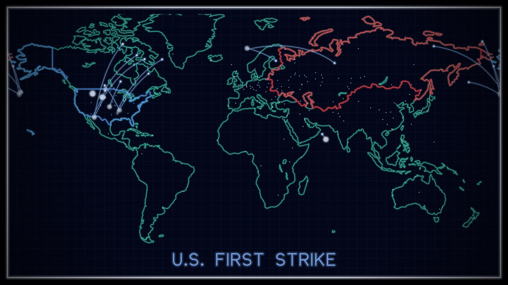
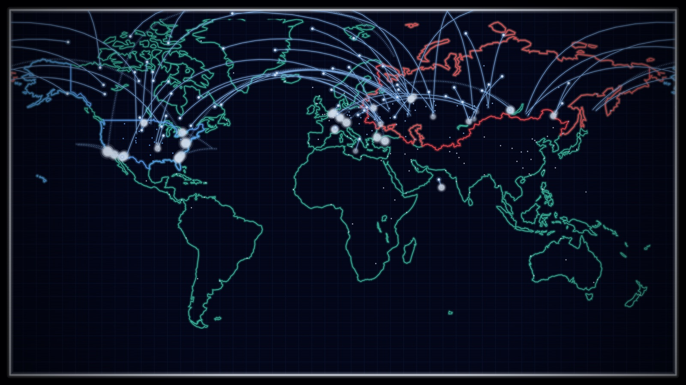
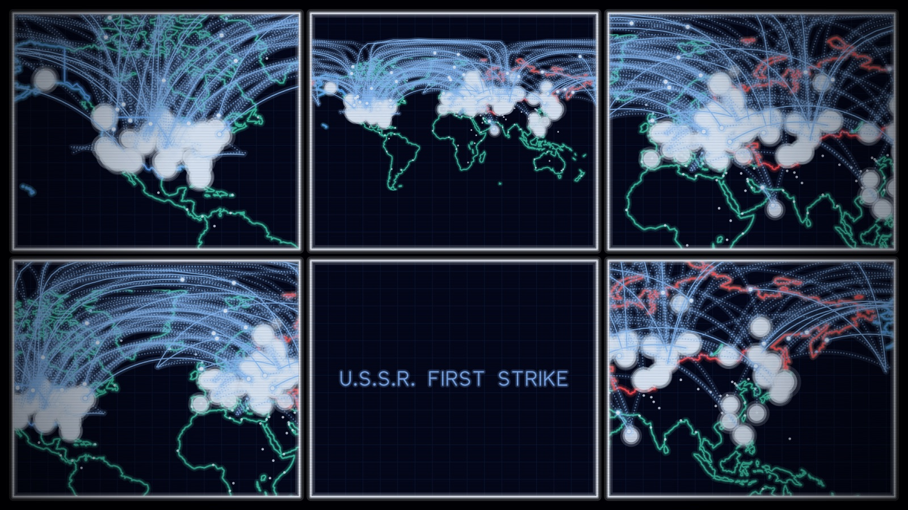
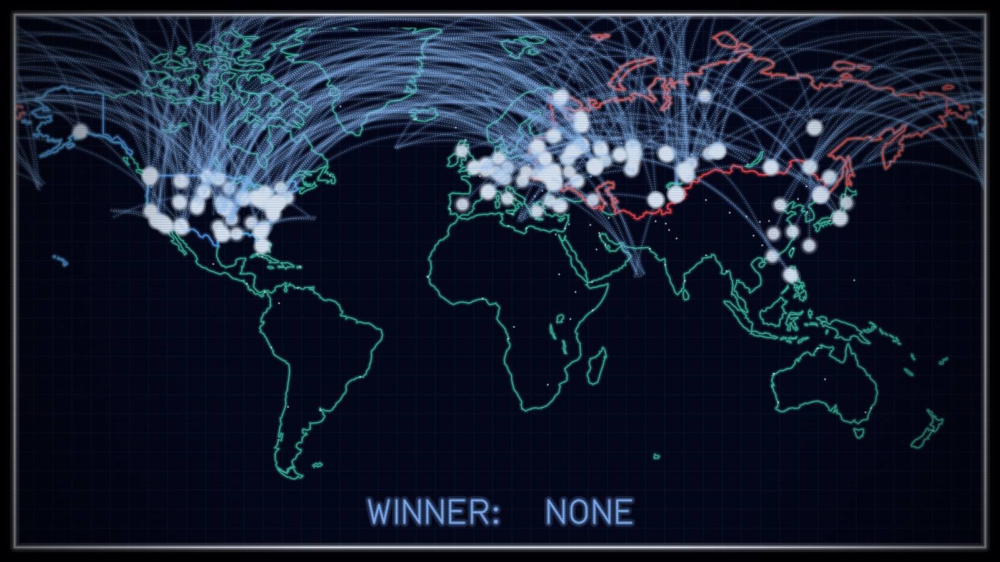
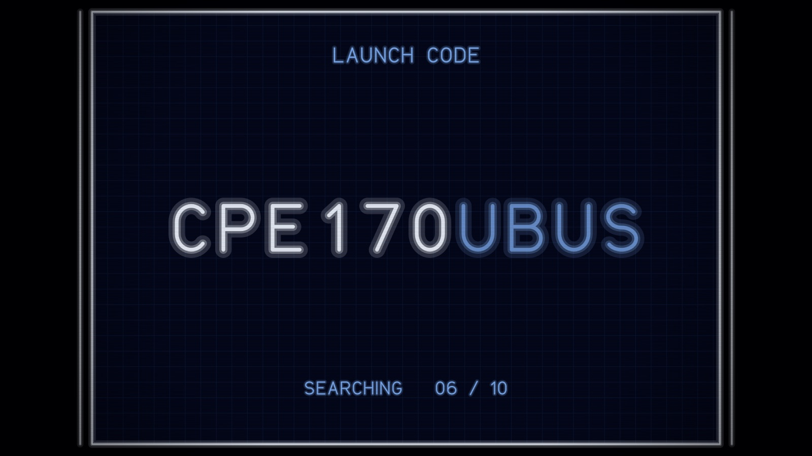
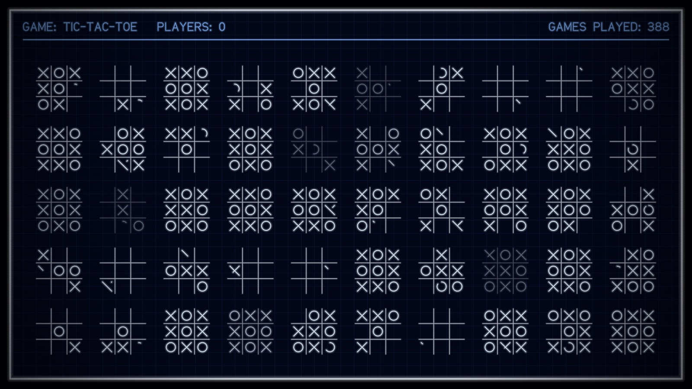
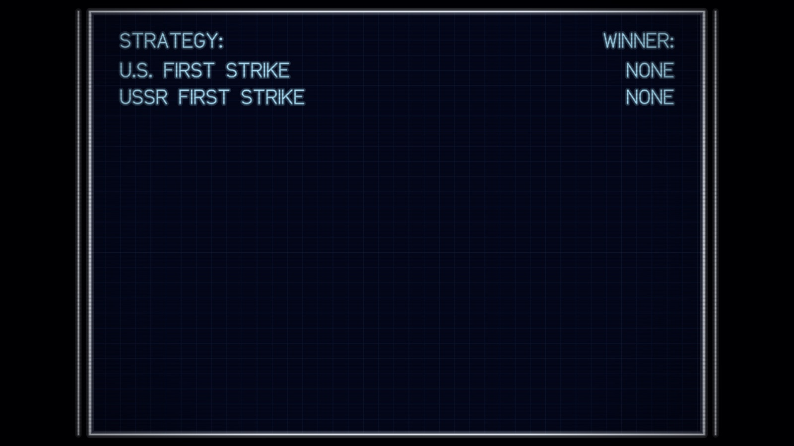

# WOPR Screen Saver

A macOS screen saver tribute to the climax of *WarGames* (1983). The WOPR
runs global thermonuclear war on the NORAD big board. It learns from
tic‑tac‑toe that nobody wins, cycles through dozens of war scenarios faster
and faster until the room strobes, and then reaches its conclusion.



| | |
|---|---|
|  |  |
|  |  |
|  |  |

Requires macOS 13 Ventura or later. It's a universal binary for Apple
silicon and Intel.

## Install

### Option 1: download (easiest)

1. Download `WOPR-ScreenSaver-<version>.zip` from the
   [Releases](../../releases) page and unzip it.
2. The saver isn't notarized by Apple, so macOS quarantines it. Clear the
   quarantine flag in Terminal:

   ```bash
   xattr -dr com.apple.quarantine ~/Downloads/WOPR.saver
   ```

3. Double‑click `WOPR.saver` and choose to install it for this user.
4. Open **System Settings → Screen Saver** and pick **WOPR**.

### Option 2: build from source

You need Xcode or the Xcode Command Line Tools (`xcode-select --install`).

```bash
git clone https://github.com/<you>/WOPR_ScreenSaver.git
cd WOPR_ScreenSaver
./build.sh install
```

This builds `WOPR.saver` and copies it to `~/Library/Screen Savers`. Then pick
**WOPR** in System Settings → Screen Saver. Builds made on your own Mac aren't
quarantined, so there's no Gatekeeper step.

### Uninstall

Delete `~/Library/Screen Savers/WOPR.saver`, or right‑click WOPR in System
Settings → Screen Saver and choose **Delete**.

## Preview without waiting for the screen saver

`./build.sh` also builds a small preview app:

```bash
open "build/WOPR Preview.app"
```

| Key | Action |
|---|---|
| Space | next act |
| 1 | intro |
| 2 | main exchange |
| 3 | tic‑tac‑toe |
| 4 | scenario cycle |
| 5 | ending |
| 6 | restart |
| F | full screen |
| Q / Esc | quit |

## The loop (about 2 minutes 50 seconds)

| Time | Act |
|---|---|
| 0:01 | Terminal: *GREETINGS PROFESSOR FALKEN… SHALL WE PLAY A GAME?* → *GLOBAL THERMONUCLEAR WAR* |
| 0:14 | **U.S.S.R. FIRST STRIKE**: a 56‑second exchange on the big board, with a cut to the wall of zoomed screens |
| 1:10 | Launch code: ten slots spin and lock into **CPE1704TKS** |
| 1:20 | Tic‑tac‑toe, zero players: one board, then a wall of boards. Every game is a draw. |
| 1:34 | Scenario cycle: U.S. FIRST STRIKE, USSR FIRST STRIKE, NATO / WARSAW PACT, FAR EAST STRATEGY, … Each scenario is shorter than the last, from 8 s down to a 0.3 s strobe. The STRATEGY / WINNER scoreboard appears between them. |
| 2:32 | Blackout, then *A STRANGE GAME. THE ONLY WINNING MOVE IS NOT TO PLAY.* |

> **Photosensitivity note:** the scenario cycle includes white strobe flashes,
> as in the film. They are kept at least 0.4 s apart, under the WCAG 3‑per‑second
> limit, but skip this saver if flashing light affects you.

## The look

The visuals were matched frame by frame against the film's NORAD big‑board
footage:

- **Screens:** rear‑projection screens with a white bezel, dark‑navy glass and
  a faint grid.
- **Map:** the United States outlined in blue, the USSR in red (its 15
  republics merged into one outline), and the rest of the world in teal.
  Target dots are pre‑plotted.
- **Lettering:** a single‑stroke vector font in the style of the film's HP
  vector displays. Scenario titles sit at the bottom, followed by
  **WINNER:**, then **NONE**.
- **Missiles:** beaded blue‑white streaks arcing over the pole, with a glowing
  flare at launch.
- **Detonations:** white blobs that swell, persist and merge into clouds.

## Development

```bash
./build.sh                  # build/WOPR.saver, build/WOPR Preview.app, build/render
./build.sh install          # build and install to ~/Library/Screen Savers
./build.sh dist             # build and package dist/WOPR-ScreenSaver-<version>.zip
```

There's no Xcode project; everything builds with plain `swiftc`. The `render`
tool draws frames offscreen for testing:

```bash
./build/render --timeline                                    # act timeline
./build/render --size 1920x1080 --out /tmp/f --times 30,95   # PNG frames at loop times
./build/render --bench --live --size 2560x1440 --scale 2     # ms per frame, live path
```

| File | Role |
|---|---|
| `Sources/Core.swift` | Scene protocol, colour palette, glow drawing, deterministic RNG |
| `Sources/WorldMap.swift` | Miller projection, great‑circle tracks, big‑board screen art |
| `Sources/MapData.swift` | Generated map data. `tools/fetch_data.sh` rebuilds it from Natural Earth. |
| `Sources/Targets.swift` | Approximate 1983‑era launch sites and targets |
| `Sources/WarScene.swift` | Scenario library, missile simulation, cameras, captions |
| `Sources/TicTacToeScene.swift` | Perfect‑play tic‑tac‑toe that always ends in a draw |
| `Sources/TerminalScene.swift` | Teletype terminal intro and ending |
| `Sources/BoardScenes.swift` | STRATEGY / WINNER scoreboard; launch‑code crack |
| `Sources/VectorFont.swift` | Single‑stroke vector lettering |
| `Sources/Director.swift` | Timeline, fades, strobe, CRT scanlines |
| `Sources/LiveRenderer.swift` | Draws the moving content each frame within a pixel budget |
| `Sources/WOPRSaverView.swift` | The `ScreenSaverView`. It stacks CALayers so the GPU composites the static art. |

### Design notes

- **Deterministic frames.** Every frame is a pure function of loop time.
  Finished missile trails build up in a cache. Each trail is drawn on its own,
  so a frame looks identical however playback reached it, including after a seek.
- **Speed.** The static screen art and scanlines render once at full Retina
  resolution, and the GPU composites them. Only the moving content is drawn on
  the CPU each frame, within a budget of about 2.3 megapixels. That averages
  about 5 ms per frame at 2560×1440 @2x.
- **Multiple displays.** Each display gets its own view and caches. On
  macOS 14 and later, the saver exits cleanly when the screen saver stops.

## Credits and disclaimer

- **Code:** MIT‑licensed. See [LICENSE](LICENSE).
- **Map data:** [Natural Earth](https://www.naturalearthdata.com/), public domain.
- **The film:** *WarGames*, WOPR, its characters and dialogue belong to their
  respective owners. This is an unofficial, non‑commercial fan tribute, not
  affiliated with or endorsed by them.
